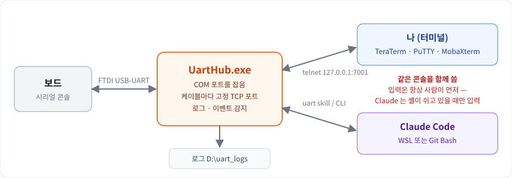
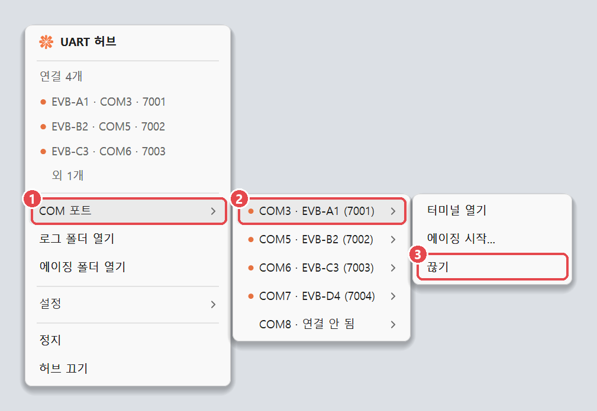

[English](README.md) | **한국어**

# UART 허브

보드 시리얼 콘솔 하나를 나와 Claude Code 가 함께 쓰게 해 주는 Windows 트레이 앱입니다.



UART 허브는 FTDI USB-시리얼 케이블을 붙잡고, 케이블마다 고정된 로컬 포트를 줍니다.
내 터미널(TeraTerm, PuTTY, MobaXterm 또는 telnet)과 [Claude Code](https://claude.com/claude-code)가 그 포트에 붙어 같은 보드 콘솔을 동시에 씁니다.
허브는 콘솔 로그를 빠짐없이 남기고, 에이징 중에는 커널 panic·앱 오류·예상 못 한 재부팅을 잡아 줍니다.

## 왜 쓰나

- **콘솔 하나, 사용자 둘.** 나와 Claude 가 같은 보드를 동시에 씁니다. 포트를 넘겨주고 받을 필요가 없습니다.
- **사람이 먼저.** 보드가 셸 프롬프트(`#` 등)에서 다음 명령을 기다리고 있고 내가 입력 중이 아닐 때만 Claude 가 입력합니다. 아니면 기다립니다.
- **진짜 결과.** Claude 가 실행한 명령은 깨끗한 출력과 보드의 종료코드로 돌아옵니다.
- **빠짐없는 기록.** 누가 붙어 있든 콘솔 로그 전체를 계속 씁니다.
- **에이징.** panic·Oops·앱 오류·재부팅을 앞뒤 로그와 함께 남기고, 심각한 것은 트레이 알림으로 알려 줍니다.



*트레이 메뉴: COM 포트 ▸ COM3 · EVB-A1 (7001) ▸ 끊기 를 누르면 다른 시리얼 프로그램이 그 포트를 쓸 수 있습니다.*

## 빠른 시작

1. [Releases](https://github.com/dltjrgud815/claude-uart-hub/releases) 에서 `UartHub_<버전>.zip` 을 받아 압축을 풉니다.
2. 폴더를 계속 둘 곳에 놓습니다. 예: `C:\Tools\UartHub_<버전>\`
   로컬 디스크여야 합니다. 네트워크 공유, USB 메모리, WSL 안은 안 됩니다.
3. Claude Code 에 이렇게 말합니다.
   ```
   C:\Tools\UartHub_<버전>\INSTALL_UART_HUB.md 를 참고해 UART 허브를 등록해줘
   ```
   작업 표시줄 오른쪽에 주황 별 아이콘이 나타나면 허브가 돌고 있는 것입니다.
   등록하면서 Claude Code 의 UART skill 도 Windows 와 WSL 에 들어갑니다.
4. FTDI 케이블을 꽂고 Claude Code 에 `/connect-uart COM3` 을 입력합니다.
   허브가 보드에 연결하고 터미널을 열어 줍니다.

따로 설치하는 것은 없습니다. 허브는 그 폴더에서 관리자 권한 없이 돕니다.
단계마다 화면이 있는 설명은 **[사용 가이드](docs/GUIDE.ko.md)** 를 보세요.

## Claude 에게 시키기

연결된 보드는 포트 번호(여기서는 7001)로 부르면 됩니다.

| 이렇게 말하면 | 이렇게 됩니다 |
|---|---|
| "7001 보드에서 uname 해줘" | Claude 가 명령을 실행하고 출력과 종료코드를 가져옵니다 |
| "7001 보드 재부팅하고 부팅 끝나면 알려줘" | Claude 가 재부팅한 뒤 셸 프롬프트가 다시 뜰 때까지 기다립니다 |
| "7001 콘솔 로그 마지막 50줄 보여줘" | Claude 가 저장된 로그에서 읽습니다. 보드로는 아무것도 보내지 않습니다 |
| "7001 에이징 시작해줘, 이름은 야간" | Claude 가 에이징 기록을 시작합니다 |
| "어젯밤 7001 에이징 결과 정리해줘" | Claude 가 panic·재부팅을 표로 정리합니다 |

연결과 끊기는 사람이 합니다.
연결 안 된 보드면 Claude 는 직접 연결하지 않고 `/connect-uart COMx` 를 입력해 달라고 부탁합니다.
다른 시리얼 프로그램으로 포트를 써야 하면 `/disconnect-uart COM3` 을 입력하거나 위 그림의 트레이 메뉴를 씁니다.

## 제품 프로필 (UartHub.profile.json)

보드와 펌웨어마다 부팅 때 찍는 문구와 앱이 오류를 알리는 방식이 다릅니다.
제품 프로필은 허브에게 내 보드를 알려 주는 JSON 파일이며, 없어도 됩니다.
이름을 `UartHub.profile.json` 으로 해서 **`UartHub.exe` 옆에** 둡니다. 정하는 것은 다음과 같습니다.

- **로더 표시**: 로더가 리셋 때마다 찍는 문구. 정해 두면 리셋을 더 확실히 셉니다.
- **부팅 줄**: 부팅이 시작됐음을 나타내는 줄(그리고 U-Boot 프롬프트).
- **앱 오류 패턴**: 잡을 앱 오류와, 그 오류에 붙일 짧은 코드.

프로필이 없으면 허브는 일반 Linux 커널 사건(panic, Oops, BUG, OOM)만 잡고, 부팅은 표준 커널 부팅 줄로 찾습니다.
앱 오류는 잡지 않습니다(`config.json` 의 `events.patterns.app_error.add` 로 더할 수는 있습니다).
재부팅하는 보드인데 에이징 요약에 재부팅이 0회로 나오면, 허브가 그 보드의 부팅 줄을 모르는 것입니다. 프로필에 `loader_marker_re` 나 `boot_re` 를 정하세요.

예시(가상 제품입니다. 이름과 문자열은 설명용입니다):

```json
{
  "name": "evb-a",
  "loader_marker_re": "LDR>T",
  "boot_re": "reboot: Restarting system|LDR>T|^\\[\\s+0\\.0\\d+\\]",
  "uboot_prompt_re": "^evb: ",
  "event_patterns": { "app_error": ["APPFAULT\\((?!(?i:BA\\)\\(000f\\)))", "APP_ABORT reason="] },
  "app_codes": [ { "re": "APPFAULT\\([^)\\s]*\\)" }, { "re": "(?i)app_wdt", "code": "WDT" } ]
}
```

여기서 `LDR>T` 는 이 가상 로더가 리셋 때마다 찍는 표시입니다.
`APPFAULT(...)` 줄은 앱 오류로 셉니다. 단, 정상 종료 코드 `APPFAULT(BA)(000f)` 는 뺍니다.

허브는 프로필을 한 번만 읽으므로, 고친 뒤에는 허브를 다시 켭니다.
깨진 프로필은 무시하고 일반 기본값으로 돌며, 이유는 `uart hub status --json` 에 나옵니다.
모든 키·기본값·우선순위는 [기술 참고](docs/REFERENCE.ko.md#3-제품-프로필-uarthubprofilejson)에 있습니다.

## 요구 사항

- Windows 10/11 x64. Windows 11 에서 개발·시험했고, Windows 10 은 확인하지 않았습니다.
- FTDI(VID_0403) USB-시리얼 어댑터와 FTDI VCP 드라이버. CH340, CP210x 등 다른 어댑터는 아직 지원하지 않습니다.
- WSL 또는 Git Bash 에서 쓰는 Claude Code.
- PC 에 그 밖에 필요한 것은 없습니다. exe 하나로 돌며 설치 프로그램, 관리자 권한, PowerShell 7, .NET 모두 필요 없습니다.
- 트레이·창·메시지와 zip 안의 문서는 한국어입니다.

## 문서

| 문서 | 내용 |
|---|---|
| [사용 가이드](docs/GUIDE.ko.md) ([English](docs/GUIDE.md)) | 그림으로 보는 설치, 보드 연결, Claude 에게 맡기기, 끊기, 에이징 |
| [INSTALL_UART_HUB.md](INSTALL_UART_HUB.md) | zip 에 들어 있는 설치 안내. Claude 가 이것을 따라 허브를 등록·업데이트·제거합니다 |
| [USAGE_ONE_PAGE.md](USAGE_ONE_PAGE.md) | 사용법 한 장 요약 |
| [기술 참고](docs/REFERENCE.ko.md) ([English](docs/REFERENCE.md)) | 구조, 모든 명령, 제품 프로필, 사건 감지, 빌드, 시험, 배포, 알려진 한계 |
| [UI_COPY.md](UI_COPY.md) | 창·트레이 메뉴·알림의 문구와 모양 |

## 빌드와 시험

빌드는 WSL 에서 하고, .NET 10 SDK 가 `~/.dotnet` 에 있어야 합니다. 시뮬레이션 시험은 하드웨어 없이 Windows PowerShell 7(`pwsh`)만 있으면 됩니다.

```bash
./build.sh                             # 새 빌드
tests/run_sim.sh --quiet --part 1/3    # 시뮬레이션 시험, 3개 중 1번째
```

배포 판 빌드, 다른 시험 실행기, 시험 격리는 [기술 참고](docs/REFERENCE.ko.md#4-빌드)에 있습니다.

## 라이선스

MIT. [LICENSE](LICENSE)를 보세요.
