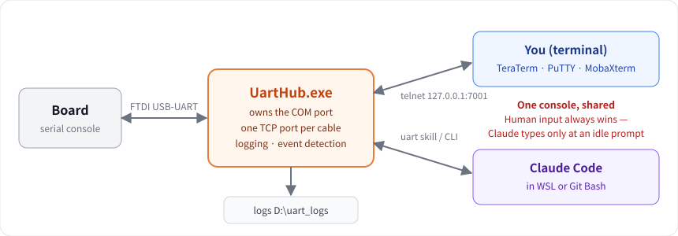
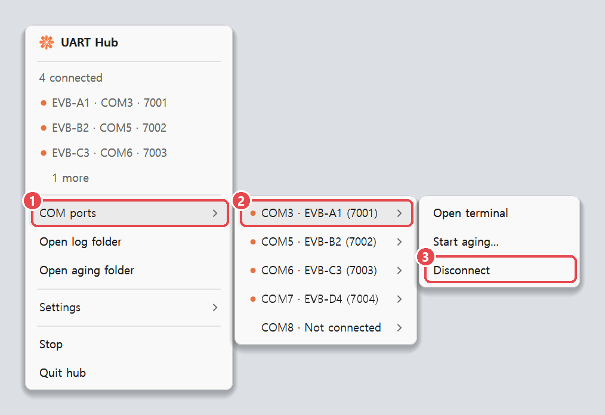

**English** | [한국어](README.ko.md)

# UART Hub

A Windows tray app that lets you and Claude Code share a board's serial console.



UART Hub holds your FTDI USB-serial cables and gives each one a fixed local port.
Your terminal (TeraTerm, PuTTY, MobaXterm or telnet) and [Claude Code](https://claude.com/claude-code) connect to that port and use the same board console at the same time.
The hub keeps the full console log, and during aging runs it catches kernel panics, app errors and unexpected reboots.

## Why use it

- You and Claude work on the same board at the same time, without handing the port back and forth.
- Your typing comes first. Claude types only when the board is sitting at its shell prompt (`#` or similar), waiting for the next command, and you are not typing. Otherwise it waits.
- Each command Claude runs comes back with its clean output and the board's exit code.
- The hub writes the full console log all the time, whoever is connected.
- During aging runs, panics, Oopses, app errors and reboots are recorded with the log around them, and the serious ones raise a tray notification.



*The tray menu: COM ports ▸ COM3 · EVB-A1 (7001) ▸ Disconnect frees the port for another serial program.*

## Quick start

1. Download `UartHub_<version>.zip` from [Releases](https://github.com/dltjrgud815/claude-uart-hub/releases) and unzip it.
2. Put the folder where it will stay, for example `C:\Tools\UartHub_<version>\`.
   It must be on a local disk: not a network share, a USB stick, or inside WSL.
3. Ask Claude Code:
   ```
   Register the UART hub by following C:\Tools\UartHub_<version>\INSTALL_UART_HUB.en.md
   ```
   When an orange star appears in the taskbar tray, the hub is running.
   Registering also gives Claude Code its UART skills, on Windows and in WSL.
4. Plug in the FTDI cable and type `/connect-uart COM3` in Claude Code.
   The hub connects to the board and opens your terminal.

There is nothing to install: the hub runs from that folder, without admin rights.
The [User guide](docs/GUIDE.md) walks through every step with screenshots.

## Ask Claude

Refer to a connected board by its port number (here 7001).

| You say | What happens |
|---|---|
| "Run uname on board 7001" | Claude runs the command and returns the output and exit code |
| "Reboot board 7001 and tell me when it's back" | Claude reboots the board and waits until the shell prompt returns |
| "Show me the last 50 lines of the 7001 console log" | Claude reads the saved log; nothing is sent to the board |
| "Start aging on 7001, call it nightly" | Claude starts an aging recording |
| "Summarize last night's aging on 7001" | Claude tabulates the panics and reboots |

You do the connecting and disconnecting yourself.
For a board that is not connected, Claude asks you to type `/connect-uart COMx` instead of doing it itself.
When you need the port for another serial program, type `/disconnect-uart COM3` or use the tray menu shown above.

## Product profile (UartHub.profile.json)

Boards and firmware differ in what they print when they boot and how their apps report errors.
A product profile is an optional JSON file that describes your board to the hub.
Name it `UartHub.profile.json` and put it **next to `UartHub.exe`**. It sets:

- the **loader marker**: a banner your loader prints on every reset, so resets are counted reliably;
- the **boot lines** that mark the start of a boot (and the U-Boot prompt);
- the **app error patterns** to catch, and the short codes used to name them.

Without a profile, the hub detects only generic Linux kernel events (panic, Oops, BUG, OOM) and finds boots by the standard kernel boot line.
App errors are not detected (you can still add patterns with `events.patterns.app_error.add` in `config.json`).
If a board that does reboot shows 0 reboots in an aging summary, the hub does not recognize that board's boot lines: set `loader_marker_re` or `boot_re` in a profile.

Example (a fictional product; the names and strings are for illustration only):

```json
{
  "name": "evb-a",
  "loader_marker_re": "LDR>T",
  "boot_re": "reboot: Restarting system|LDR>T|^\\[\\s+0\\.0\\d+\\]",
  "uboot_prompt_re": "^evb: ",
  "event_patterns": { "app_error": ["APPFAULT\\((?!(?i:BA\\)\\(000f\\)))", "APP_ABORT reason="] },
  "app_codes": [ { "re": "APPFAULT\\([^)\\s]*\\)" }, { "re": "(?i)app_wdt", "code": "WDT" } ]
}
```

Here `LDR>T` is what this fictional loader prints on every reset.
`APPFAULT(...)` lines count as app errors, except the normal-exit code `APPFAULT(BA)(000f)`.

The hub reads the profile when it starts, so restart the hub after editing it.
A broken profile is ignored (the hub falls back to the generic defaults), and the reason is shown by `uart hub status --json`.
Every key, default and precedence rule is in the [Technical reference](docs/REFERENCE.md#3-product-profile-uarthubprofilejson).

## Requirements

- Windows 10/11 x64. Developed and tested on Windows 11; Windows 10 is not verified.
- FTDI (VID_0403) USB-serial adapters with the FTDI VCP driver. CH340, CP210x and other adapters are not supported yet.
- Claude Code in WSL or Git Bash.
- Nothing else to install. The hub is a single portable exe and needs no installer, admin rights, PowerShell 7 or .NET runtime.
- The tray, dialogs, messages and aging files follow the Windows display language: Korean if Windows is set to Korean, otherwise English. To switch, use tray → Settings → Language.

## Documentation

| Document | What's in it |
|---|---|
| [User guide](docs/GUIDE.md) ([한국어](docs/GUIDE.ko.md)) | Illustrated: install, connect a board, let Claude work, disconnect, aging runs |
| [INSTALL_UART_HUB.en.md](INSTALL_UART_HUB.en.md) ([한국어](INSTALL_UART_HUB.md)) | Install guide shipped in the zip; Claude follows it to register, update or remove the hub |
| [USAGE_ONE_PAGE.en.md](USAGE_ONE_PAGE.en.md) ([한국어](USAGE_ONE_PAGE.md)) | One-page usage summary |
| [Technical reference](docs/REFERENCE.md) ([한국어](docs/REFERENCE.ko.md)) | Architecture, all commands, product profile, event detection, build, tests, releases, known limitations |
| [UI_COPY.md](UI_COPY.md) | Text and look of the windows, tray menu and notifications (Korean) |

## Build & test

Build in WSL with the .NET 10 SDK in `~/.dotnet`. The simulation tests need no hardware, only PowerShell 7 (`pwsh`) on Windows.

```bash
./build.sh                             # new build
tests/run_sim.sh --quiet --part 1/3    # simulation tests, part 1 of 3
```

Release builds, the other test runners and test isolation are covered in the [Technical reference](docs/REFERENCE.md#4-build).

## License

MIT. See [LICENSE](LICENSE).
