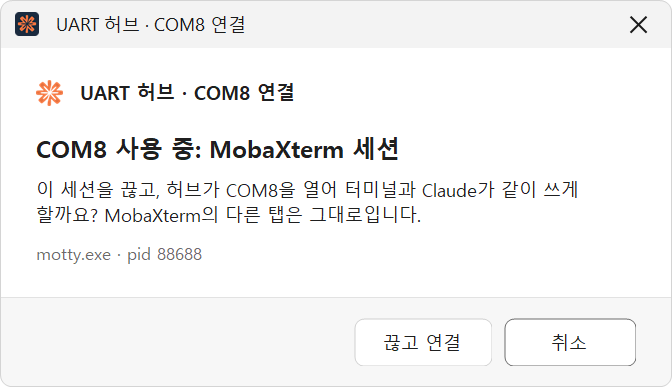
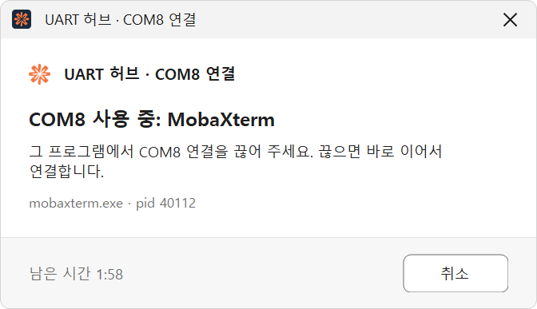
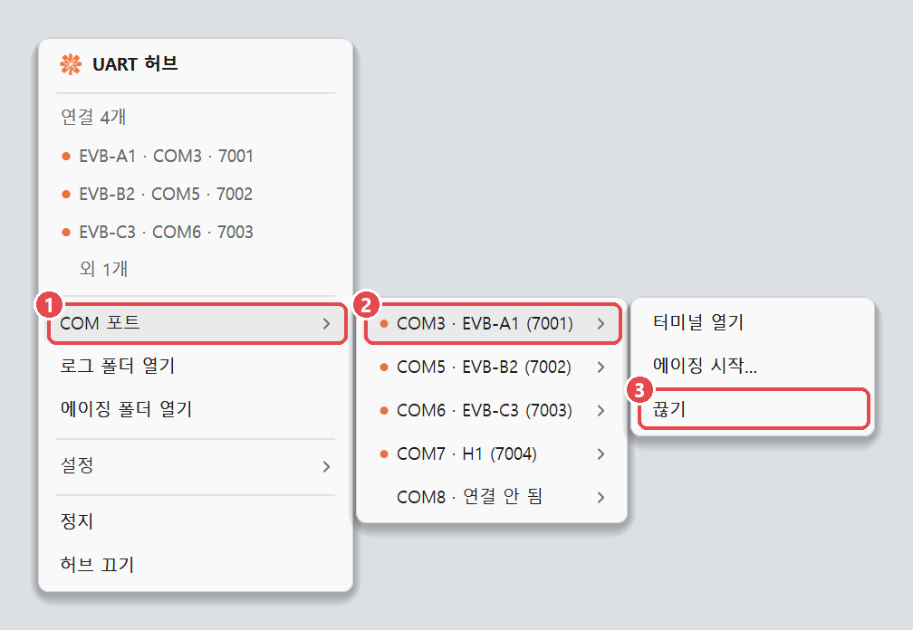
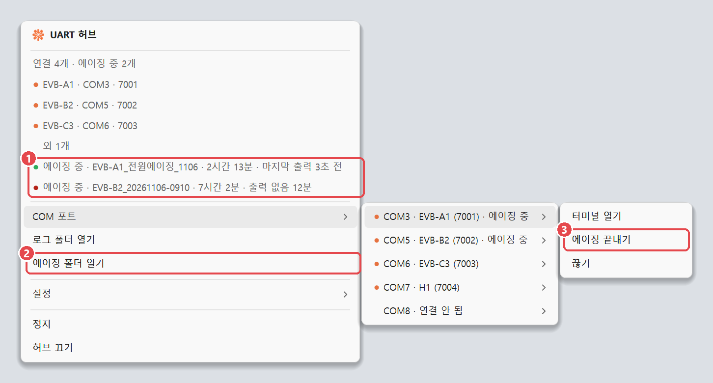

[English](GUIDE.md) | **한국어**

# UART 허브 사용 가이드

보드 시리얼 콘솔 하나를 **내 터미널과 Claude Code 가 같이 쓰게** 해 주는 Windows 도구입니다.
터미널로 보드를 보면서 "이 보드에서 `uname` 해줘", "재부팅하고 부팅 끝나면 알려줘"처럼 Claude 에게 일을 맡길 수 있습니다.
연결해 둔 동안 허브가 로그를 남기고, 에이징 중에는 panic·Oops·앱 오류를 잡아 알려 줍니다.


**입력은 항상 사람이 먼저입니다.** 내가 터미널에 치고 있으면 Claude 는 보내지 않고 기다립니다.

## 목차

1. [준비물](#1-준비물)
2. [설치 — 처음 한 번](#2-설치--처음-한-번)
3. [보드 연결하기](#3-보드-연결하기)
4. [Claude 에게 맡기기](#4-claude-에게-맡기기)
5. [내 시리얼 프로그램으로 쓰고 싶을 때 (끊기)](#5-내-시리얼-프로그램으로-쓰고-싶을-때-끊기)
6. [에이징 걸어 두기](#6-에이징-걸어-두기)
7. [로그는 어디에 남나요](#7-로그는-어디에-남나요)
8. [업데이트 · 끄기 · 제거](#8-업데이트--끄기--제거)
9. [자주 묻는 것](#9-자주-묻는-것)

---

## 1. 준비물

| 항목 | 내용 |
|---|---|
| PC | Windows 10 / 11 (64비트). 관리자 권한은 필요 없습니다 |
| 케이블 | **FTDI 칩(VID_0403)** USB-UART 케이블. CP210x·CH340 케이블은 아직 인식하지 못합니다 |
| Claude Code | WSL 또는 Windows(Git Bash) 어느 쪽이든 됩니다 |
| 터미널(선택) | TeraTerm · PuTTY · MobaXterm 중 하나. 없으면 `127.0.0.1:<포트>` 로 telnet 하면 됩니다 |

## 2. 설치 — 처음 한 번

허브는 **설치하지 않고**, 압축을 푼 폴더에서 그대로 실행합니다. 시작프로그램이나 레지스트리를 건드리지 않습니다.

1. [Releases](https://github.com/dltjrgud815/claude-uart-hub/releases) 에서 `UartHub_<버전>.zip` 을 받아 압축을 풉니다.
2. 풀린 폴더를 **늘 둘 곳**에 둡니다. 예: `C:\Tools\UartHub_<버전>\`
   - 네트워크 폴더·USB 메모리·WSL 안은 안 됩니다.
   - 등록한 뒤에는 폴더를 옮기거나 지우지 마세요. 허브가 그 자리에서 실행됩니다.
3. Claude Code 에 이렇게 말합니다.
   ```
   C:\Tools\UartHub_<버전>\INSTALL_UART_HUB.md 를 참고해 UART 허브를 등록해줘
   ```
   Claude 가 할 일을 먼저 보여 준 뒤 등록합니다. 더블클릭이나 확인 창은 없습니다.
4. 작업 표시줄 오른쪽에 **주황 별 아이콘**이 생기면 끝입니다. 안 보이면 `^`(숨겨진 아이콘 표시) 안에 있습니다.

   

   | 아이콘 | 뜻 |
   |---|---|
   | 주황 별 (run) | 허브 실행 중 |
   | 주황 별 + 초록 점 (rec) | 에이징 기록 중 |
   | 주황 별 + 빨간 점 (warn) | 확인 필요 — 허브가 계속 꺼지거나 설정 파일에 오류가 있음 |
   | 회색 별 (stop) | 정지됨(트레이 → **시작** 으로 다시 켭니다) |

5. Claude Code 에 **`/connect-uart`** 를 입력해 봅니다. 슬래시 명령 목록에 없으면 Claude Code 세션을 새로 시작하세요.

> **로그온할 때 자동으로 켜려면** (직접 한 번): Win+R → `shell:startup` → 열린 폴더에 `UartHub.exe` 를 **오른쪽 버튼으로 끌어 놓고 "바로 가기 만들기"**.
>
> **"게시자를 확인할 수 없습니다" 경고가 뜨면**: `UartHub.exe` 오른쪽 버튼 → 속성 → 아래쪽 **"차단 해제"** 체크 → 확인. 서명하지 않은 exe 라서 뜨는 경고입니다.

## 3. 보드 연결하기

허브는 **내가 연결하라고 한 COM 만** 잡습니다. 케이블을 꽂기만 해서는 잡지 않습니다.

| 하고 싶은 것 | Claude Code 에 입력 |
|---|---|
| 꽂힌 COM 목록 보기 | `/connect-uart` |
| COM3 연결 | `/connect-uart COM3` |
| 속도가 다른 보드 (예: 9600) | `/connect-uart COM3 9600` |
| 연결 끊기 | `/disconnect-uart COM3` |

연결되면 이렇게 됩니다.

- **터미널이 바로 열립니다.** 설치된 것 중 TeraTerm → PuTTY → MobaXterm 순으로 고릅니다.
- 바탕화면에 **`EVB-A1 (7001)`** 같은 아이콘이 생깁니다. 터미널을 닫은 뒤에는 이 아이콘을 더블클릭해 다시 엽니다.
- 포트 번호(7001, 7002…)는 처음 연결할 때 받고 **그 케이블에 고정**됩니다. 케이블에 라벨을 붙여 두면 편합니다.
- **터미널을 닫아도 연결은 끊기지 않습니다.** 허브가 COM 을 계속 잡고 로그를 남깁니다. 끊으려면 [5장](#5-내-시리얼-프로그램으로-쓰고-싶을-때-끊기)을 보세요.

### 다른 프로그램이 그 COM 을 쓰고 있으면

화면에 창이 뜹니다. 허브가 그 프로그램을 알아보는지에 따라 두 가지입니다.

**MobaXterm 세션 · TeraTerm · PuTTY · KiTTY** — **[끊고 연결]** 을 누르면 **그 세션 하나만** 끝내고 연결합니다. MobaXterm 의 다른 탭은 그대로입니다.



**그 밖의 프로그램** — 허브가 끝내지 않습니다. 그 프로그램에서 연결을 끊으면 **바로 이어서 연결**합니다(최대 2분 기다림).



## 4. Claude 에게 맡기기

연결한 보드는 **포트 번호**로 부르면 가장 정확합니다.

| 이렇게 말하면 | Claude 가 하는 일 |
|---|---|
| "7001 보드에서 uname 해줘" | 명령을 실행하고 출력과 종료코드를 가져옵니다 |
| "7001 보드 재부팅하고 부팅 끝나면 알려줘" | 재부팅 → 프롬프트가 다시 뜰 때까지 기다립니다 |
| "7001 콘솔 로그 마지막 50줄 보여줘" | 저장된 로그에서 읽습니다(보드로는 아무것도 보내지 않음) |
| "7001 에이징 시작해줘, 이름은 야간" | 에이징 기록을 시작합니다([6장](#6-에이징-걸어-두기)) |
| "어젯밤 7001 에이징 결과 정리해줘" | panic·재부팅을 표로 정리합니다 |

알아 두면 좋은 것:

- **내가 터미널에 치고 있으면 Claude 는 보내지 않습니다.** "사람이 입력 중"이라고 알려 주고 기다립니다.
- Claude 는 **스스로 연결하거나 끊지 않습니다.** 연결 안 된 보드면 "`/connect-uart COMx` 를 입력해 주세요"라고 부탁합니다. 다른 프로그램의 세션을 끝낼 수 있는 일이라 사람만 합니다.
- 처음 쓸 때 Claude Code 가 **실행 허용**을 한 번 묻습니다. 다시 묻지 않게 하는 항목을 고르면 됩니다.
- Claude 가 "보드 출력이 아직 없습니다"라고 하면 보드 전원·배선을 확인하고 터미널에서 Enter 를 쳐 보세요.

## 5. 내 시리얼 프로그램으로 쓰고 싶을 때 (끊기)

허브가 COM 을 잡고 있는 동안에는 다른 프로그램이 그 COM 을 열 수 없습니다. Claude 세션을 닫거나 케이블을 뽑았다 꽂아도 마찬가지라서, **먼저 끊어야 합니다.**

트레이의 주황 별 아이콘을 **오른쪽 클릭** → **① COM 포트** → **② 그 COM** → **③ 끊기**



또는 Claude Code 에 `/disconnect-uart COM3` 을 입력해도 같습니다. 끊은 뒤에는 다시 `/connect-uart` 할 때까지 허브가 그 COM 을 잡지 않습니다.

> 허브 전체를 잠깐 멈추려면 트레이 메뉴의 **정지**(다시 쓸 때 **시작**)를 누릅니다.

## 6. 에이징 걸어 두기

에이징은 **이름을 붙여 시작하고 끝냅니다.** 그 사이의 콘솔 로그와 이벤트가 한 폴더에 모입니다.

### 시작

트레이 → COM 포트 → 그 COM → **에이징 시작…** → 이름을 정하고 **[시작]**. 이름의 기본값은 `<보드>_<날짜-시각>` 입니다.


Claude 에게 "7001 에이징 시작해줘, 이름은 야간"이라고 해도 됩니다.

### 기록 중인지 보기



- **① 상태 줄**: 에이징 중인 보드와 경과 시간이 보입니다. 초록 점은 출력이 잘 들어오는 중, **빨간 점(출력 없음 N분)** 은 10분 넘게 출력이 없다는 뜻이니 보드와 케이블을 확인하세요.
- **② 에이징 폴더 열기**: 기록 폴더를 바로 엽니다.
- **③ 에이징 끝내기**: 기록을 마치고 요약을 씁니다. Claude 에게 "7001 에이징 끝내고 정리해줘"라고 해도 됩니다.
- 트레이 아이콘에 **초록 점**이 붙고, 터미널 창 제목 끝에 " · 에이징 중"이 붙습니다.

### 무엇이 남나요

```
D:\uart_logs\에이징\야간_20261106-1530\
├─ 콘솔.log        그 포트의 콘솔 줄 전체
├─ 이벤트\          알릴 만한 사건마다 txt 하나
│   ├─ 173851_커널패닉.txt
│   └─ 180212_앱오류_APPFAULT(ED).txt
└─ 요약.txt        에이징 끝낼 때: 기간 · 부팅 수 · 이벤트 목록 · 기록이 끊긴 구간
```

- **풍선 알림은 Kernel panic · Oops · 앱 오류일 때만** 뜹니다(panic 뒤 재부팅, panic 뒤 응답 없음 포함). 풍선을 누르면 그 txt 가 메모장으로 열립니다.
- 그 밖의 재부팅·BUG·OOM 은 **기록만** 합니다. 전원 on/off 에이징은 매 회차가 리셋이라 알림이 넘치기 때문입니다.
- 이벤트 txt 맨 위에는 종류·보드·시각·원인 줄이, 그 아래에는 앞 200줄과 이후 줄이, 끝에는 **`결과:`**(재부팅함 / 응답 없음 / 계속 동작)가 있습니다.
- `dmesg` 나 로그 파일 `cat` 처럼 **명령 출력 속에 보인 오류**는 옛 로그일 수 있어 `_의심` 을 붙여 기록만 합니다. 바로 뒤에 보드가 리셋되거나 응답이 없어지면 그때 알립니다.
- **앱 오류**를 잡으려면 보드 펌웨어에 맞는 **제품 프로필**(`UartHub.profile.json`)이 exe 옆에 있어야 합니다. 형식은 [README 의 제품 프로필](../README.ko.md) 절을 보세요. 프로필이 없어도 커널 panic·Oops·재부팅은 잡습니다.
- **재부팅하는 보드인데 요약에 재부팅이 0회로 나오면**, 허브가 그 보드의 부팅 줄을 모르는 것입니다(로더 문구가 다르거나 커널이 조용한 보드). Claude 가 콘솔 로그에서 직접 세어 알려 주고, 제품 프로필의 `loader_marker_re`·`boot_re` 를 그 보드에 맞추면 다음부터 셉니다.
- 허브를 껐다 켜도 같은 에이징에 이어서 기록합니다.

아침에는 Claude 에게 **"어젯밤 7001 에이징 결과 정리해줘"** 라고 하면 사건 표로 정리해 줍니다. 정리하는 동안 보드로는 아무것도 보내지 않습니다.

## 7. 로그는 어디에 남나요

- 기본 위치는 `D:\uart_logs` 입니다(D: 가 없으면 `%USERPROFILE%\uart_logs`). 트레이 → **로그 폴더 열기** 로 바로 엽니다.
- `에이징\` 아래에 에이징 세션마다 폴더가 생깁니다. 허브 설정과 `hub.log` 는 `hub\` 에 있습니다.
- 에이징 밖의 콘솔 줄은 숨김 임시 기록에 **24시간만**(합계 2GB까지) 둡니다. 오래 남겨야 하는 기록은 에이징으로 받으세요.
- `hub\config.json` 은 지우지 마세요.

## 8. 업데이트 · 끄기 · 제거

| 하고 싶은 것 | 방법 |
|---|---|
| 업데이트 | 새 `UartHub_<새 버전>` 폴더를 받아 같은 말을 합니다: "`<새 폴더>\INSTALL_UART_HUB.md` 를 참고해 UART 허브를 등록해줘". 포트·연결·로그는 그대로 이어집니다. 옛 폴더는 확인 뒤 직접 지우세요 |
| 끄기 | 트레이 → **허브 끄기**. Claude 가 허브를 부르거나 바탕화면 아이콘을 누르면 다시 켜집니다 |
| 제거 | Claude 에게 "INSTALL_UART_HUB.md 의 제거 방법대로 UART 허브를 제거해줘". 바탕화면 아이콘·Claude skills·등록 정보만 지우고 **exe 와 로그는 남깁니다** |

## 9. 자주 묻는 것

**트레이 아이콘이 안 보여요.**
작업 표시줄 오른쪽 `^`(숨겨진 아이콘 표시) 안에 있습니다. 끌어서 밖으로 꺼내 두면 편합니다.

**`/connect-uart` 가 명령 목록에 없어요.**
Claude Code 세션을 새로 시작하세요. 허브보다 Claude Code 를 나중에 설치했다면 2장의 등록 부탁을 한 번 더 하세요.

**4채널 어댑터의 COM 번호가 바뀌었어요.**
다른 USB 포트에 꽂으면 Windows 가 새 번호를 줍니다. 늘 같은 USB 포트에 꽂으세요. 남은 옛 기록은 트레이 → 설정 → **미연결 UART 정리**에서 지웁니다.

**동작이 이상해요.**
트레이 → **허브 끄기** → 폴더의 `UartHub.exe` 더블클릭. 그래도 이상하면 `D:\uart_logs\hub\hub.log` 를 첨부해 [Issues](https://github.com/dltjrgud815/claude-uart-hub/issues) 에 남겨 주세요.

**CH340·CP210x 케이블은요?**
아직 FTDI(VID_0403)만 인식합니다.

**Claude 가 내 입력을 끊고 끼어들 수 있나요?**
아니요. 허브는 셸 프롬프트 상태를 따라가서, 셸이 프롬프트에서 쉬고 있고 사람이 치고 있지 않을 때만 Claude 의 입력을 보냅니다. 그렇지 않으면 아무것도 보내지 않고 Claude 에게 "기다려"(종료코드 101)라고 돌려줍니다.

---

더 자세한 동작(명령 전체, 종료코드, 설정 키, 빌드·시험)은 [README](../README.ko.md) 와 [USAGE_ONE_PAGE.md](../USAGE_ONE_PAGE.md) 에 있습니다.
