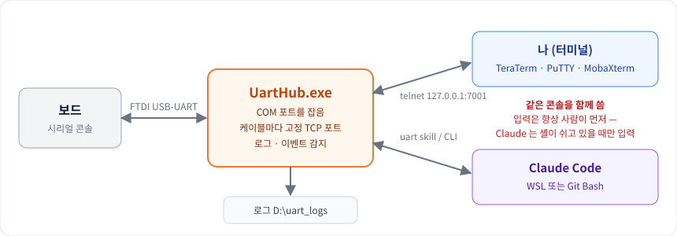
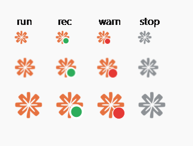
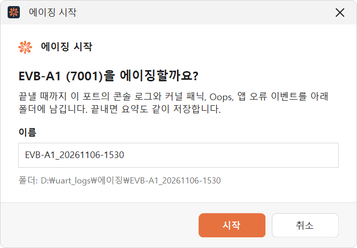
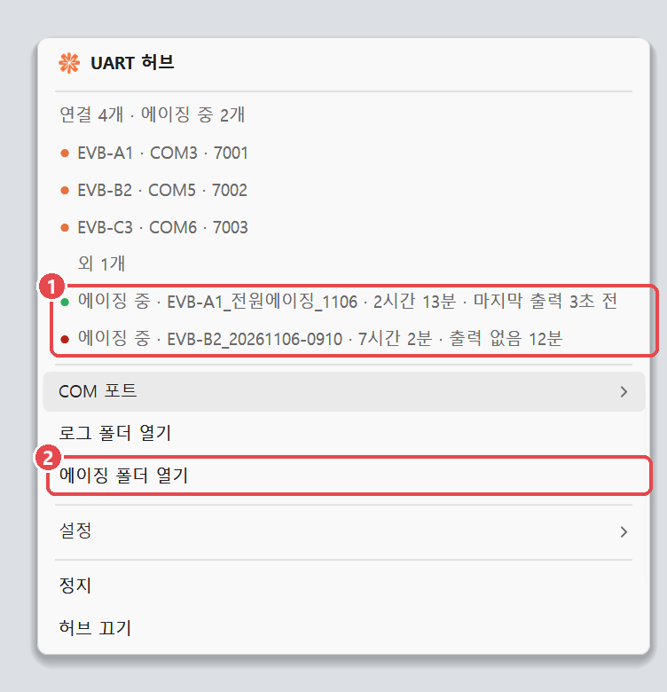
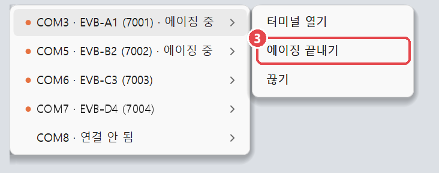

[English](GUIDE.md) | **한국어**

# UART 허브 사용 가이드

보드 시리얼 콘솔 하나를 **내 터미널과 Claude Code 가 같이 쓰게** 해 주는 Windows 도구입니다.
터미널로 보드를 보면서 "이 보드에서 `uname` 해줘", "재부팅하고 부팅 끝나면 알려줘"처럼 Claude 에게 일을 맡길 수 있습니다.
연결해 둔 동안 허브가 로그를 남기고 에이징 중에는 panic·Oops·앱 오류를 잡아 알려 줍니다.



**입력은 항상 사람이 먼저입니다.** 내가 터미널에 치고 있으면 Claude 는 보내지 않고 기다립니다.

> 화면 언어는 Windows 표시 언어를 따릅니다. Windows 가 한국어면 한국어, 아니면 영어로 보입니다. 트레이 → **설정 ▸ 언어**(자동 / 한국어 / English)에서 바꿀 수 있습니다([자주 묻는 것](#9-자주-묻는-것)).

## 목차

1. [준비물](#1-준비물)
2. [설치 — 처음 한 번](#2-설치--처음-한-번)
3. [보드 연결하기](#3-보드-연결하기)
4. [Claude 에게 맡기기](#4-claude-에게-맡기기)
5. [COM 을 직접 여는 프로그램을 쓸 때 (끊기)](#5-com-을-직접-여는-프로그램을-쓸-때-끊기)
6. [에이징 걸어 두기](#6-에이징-걸어-두기)
7. [로그는 어디에 남나요](#7-로그는-어디에-남나요)
8. [업데이트 · 끄기 · 제거](#8-업데이트--끄기--제거)
9. [자주 묻는 것](#9-자주-묻는-것)

---

## 1. 준비물

| 항목 | 내용 |
|---|---|
| PC | Windows 10 / 11 (64비트). 관리자 권한은 필요 없습니다 |
| 케이블 | **FTDI 칩(VID_0403)** USB-UART 케이블. 확인: 장치 관리자 → 포트(COM & LPT) → 그 케이블 → 속성 → 자세히 → 하드웨어 ID 에 `VID_0403` 이 있으면 됩니다. CP210x·CH340 같은 다른 칩 케이블은 `/connect-uart` 목록에 나오지 않습니다 |
| Claude Code | WSL 또는 Windows(Git Bash) 어느 쪽이든 됩니다 |
| 터미널(선택) | TeraTerm · PuTTY · MobaXterm 중 하나. 셋 다 없으면 PuTTY(포터블)를 받아 트레이 → 설정 ▸ 터미널 프로그램 ▸ 찾아보기… 로 고르세요(Windows telnet 클라이언트는 기본으로 꺼져 있고 켜려면 관리자 권한이 필요합니다) |

## 2. 설치 — 처음 한 번

허브는 **설치하지 않고** 압축을 푼 폴더에서 그대로 실행합니다. 시작프로그램이나 레지스트리를 건드리지 않습니다.

1. [Releases](https://github.com/dltjrgud815/claude-uart-hub/releases) 에서 `UartHub_<버전>.zip` 을 받아 압축을 풉니다.
2. 풀린 폴더를 **늘 둘 곳**에 둡니다. 예: `C:\Tools\UartHub_<버전>\`
   - 네트워크 폴더·USB 메모리·WSL 안은 안 됩니다.
   - 등록한 뒤에는 폴더를 옮기거나 지우지 마세요. 허브가 그 자리에서 실행됩니다.
3. Claude Code 에 이렇게 말합니다.
   ```
   C:\Tools\UartHub_<버전>\INSTALL_UART_HUB.md 를 참고해 UART 허브를 등록해줘
   ```
   Claude 가 할 일을 먼저 보여 준 뒤 등록합니다. Windows 확인 창은 뜨지 않습니다(Claude Code 가 명령 실행 허용을 물을 수는 있습니다).
4. 작업 표시줄 오른쪽에 **주황 별 아이콘**이 생기면 끝입니다. 안 보이면 `^`(숨겨진 아이콘 표시) 안에 있습니다.

   

   | 아이콘 | 뜻 |
   |---|---|
   | 주황 별 (run) | 허브 실행 중 |
   | 주황 별 + 초록 점 (rec) | 에이징 기록 중 |
   | 주황 별 + 빨간 점 (warn) | 확인 필요 — 허브가 계속 꺼지거나 설정 파일에 오류가 있음 |
   | 회색 별 (stop) | 정지됨(트레이 → **시작** 으로 다시 켭니다) |

5. Claude Code 에 **`/connect-uart`** 를 입력해 봅니다. 슬래시 명령 목록에 없으면 Claude Code 세션을 새로 시작하세요.

> **로그온할 때 자동으로 켜려면** (직접 한 번): Win+R → `shell:startup` → 열린 폴더에 `UartHub.exe` 를 **오른쪽 버튼으로 끌어 놓고 "바로 가기 만들기"**.
>
> **바탕화면 아이콘을 열 때 "게시자를 확인할 수 없습니다" 경고가 뜨면**: `UartHub.exe` 오른쪽 버튼 → 속성 → 아래쪽 **"차단 해제"** 체크 → 확인. 서명하지 않은 exe 라서 뜨는 경고입니다.

## 3. 보드 연결하기

허브는 **내가 연결하라고 한 COM 만** 잡습니다. 케이블을 꽂기만 해서는 잡지 않습니다.

| 하고 싶은 것 | Claude Code 에 입력 |
|---|---|
| 꽂힌 COM 목록 보기 | `/connect-uart` |
| COM3 연결 | `/connect-uart COM3` |
| 속도가 다른 보드 (예: 9600) | `/connect-uart COM3 9600` |
| 연결 끊기 | `/disconnect-uart COM3` |

연결되면 이렇게 됩니다.

- **터미널이 바로 열립니다.** 설치된 것 중 TeraTerm → PuTTY → MobaXterm 순으로 고릅니다.
- 바탕화면에 **`EVB-A1 (7001)`** 같은 아이콘이 생깁니다. 터미널을 닫은 뒤에는 이 아이콘을 더블클릭해 다시 엽니다.
- 포트 번호(7001, 7002…)는 처음 연결할 때 받고 **그 케이블에 고정**됩니다. 케이블에 라벨을 붙여 두면 편합니다.
- 속도(기본 115200)도 **그 케이블에 기억**됩니다. 다음부터는 `/connect-uart COM3` 만 쳐도 그 속도로 엽니다. 속도가 다른 보드에 꽂으면 터미널에 깨진 글자가 나오니, 맞는 속도를 붙여 다시 연결하세요.
- **터미널을 닫아도 연결은 끊기지 않습니다.** 허브가 COM 을 계속 잡고 로그를 남깁니다.

### MobaXterm 그대로 쓰기

COM 을 끊지 않고도 MobaXterm 으로 같은 콘솔을 볼 수 있습니다. MobaXterm 에서 새 **Telnet** 세션을 만들고 호스트 `127.0.0.1`, 포트 `7001`(그 보드의 포트 번호)로 여세요. 허브·Claude 와 같은 콘솔을 함께 씁니다.

바탕화면 아이콘이 여는 터미널은 트레이 → **설정 ▸ 터미널 프로그램** 에서 바꿉니다. 펌웨어 다운로드 도구처럼 **COM 을 직접 열어야 하는 프로그램**만 [5장](#5-com-을-직접-여는-프로그램을-쓸-때-끊기)의 방법으로 끊고 씁니다.

### 다른 프로그램이 그 COM 을 쓰고 있으면

화면에 창이 뜹니다. 허브가 그 프로그램을 알아보는지에 따라 두 가지입니다.

**MobaXterm 세션 · TeraTerm · PuTTY · KiTTY** — **[끊고 연결]** 을 누르면 **그 세션 하나만** 끝내고 연결합니다. MobaXterm 의 다른 탭은 그대로입니다.


**그 밖의 프로그램**(COM 을 직접 잡은 MobaXterm 본체, 다른 시리얼 프로그램 등) — 허브가 끝내지 않습니다. 그 프로그램에서 연결을 끊으면 **바로 이어서 연결**합니다. 창에 남은 시간이 보이고 최대 2분 기다립니다. 그 안에 끊지 못했으면, 끊은 뒤 `/connect-uart COM8` 을 다시 입력하세요.


## 4. Claude 에게 맡기기

연결한 보드는 **포트 번호**로 부르면 가장 정확합니다.

| 이렇게 말하면 | Claude 가 하는 일 |
|---|---|
| "7001 보드에서 uname 해줘" | 명령을 실행하고 출력과 종료코드를 가져옵니다 |
| "7001 보드 재부팅하고 부팅 끝나면 알려줘" | 재부팅 → 프롬프트가 다시 뜰 때까지 기다립니다 |
| "7001 콘솔 로그 마지막 50줄 보여줘" | 저장된 로그에서 읽습니다(보드로는 아무것도 보내지 않음) |
| "7001 에이징 시작해줘, 이름은 야간" | 에이징 기록을 시작합니다([6장](#6-에이징-걸어-두기)) |
| "어젯밤 7001 에이징 결과 정리해줘" | panic·재부팅을 표로 정리합니다 |

알아 두면 좋은 것:

- **내가 터미널에 치고 있으면 Claude 는 보내지 않습니다.** "사람이 입력 중"이라고 알려 주고 기다립니다.
- Claude 는 **스스로 연결하거나 끊지 않습니다.** 연결 안 된 보드면 "`/connect-uart COMx` 를 입력해 주세요"라고 부탁합니다. 다른 프로그램의 세션을 끝낼 수 있는 일이라 사람만 합니다.
- Claude Code 가 **실행 허용**을 묻습니다(프로젝트 폴더마다 처음 한 번). 다시 묻지 않게 하는 항목을 고르면 됩니다.
- Claude 가 "보드 출력이 아직 없습니다"라고 하면 보드 전원·배선을 확인하고 터미널에서 Enter 를 쳐 보세요.

## 5. COM 을 직접 여는 프로그램을 쓸 때 (끊기)

터미널로 보기만 할 때는 끊을 필요가 없습니다([MobaXterm 그대로 쓰기](#mobaxterm-그대로-쓰기)). 펌웨어 다운로드 도구처럼 COM 을 직접 열어야 하는 프로그램을 쓸 때만 끊습니다.
허브가 COM 을 잡고 있는 동안에는 다른 프로그램이 그 COM 을 열 수 없습니다. Claude 세션을 닫거나 케이블을 뽑았다 꽂아도 마찬가지입니다.

트레이의 주황 별 아이콘을 **오른쪽 클릭** → **① COM 포트** → **② 그 COM** → **③ 끊기**


또는 Claude Code 에 `/disconnect-uart COM3` 을 입력해도 같습니다. 끊은 뒤에는 다시 `/connect-uart` 할 때까지 허브가 그 COM 을 잡지 않습니다.

> 허브 전체를 잠깐 멈추려면 트레이 메뉴의 **정지**(다시 쓸 때 **시작**)를 누릅니다.

## 6. 에이징 걸어 두기

에이징은 **이름을 붙여 시작하고 끝냅니다.** 그 사이의 콘솔 로그와 이벤트가 한 폴더에 모입니다.

> **밤새 걸기 전에**
> - PC 절전(잠자기)을 끄세요.
> - 로그온할 때 허브가 켜지도록 [2장](#2-설치--처음-한-번)의 시작프로그램 바로 가기를 만들어 두세요. 바로 가기가 없으면 허브는 로그온 때 저절로 켜지지 않습니다.
> - 에이징은 연결된 COM 에서만 시작됩니다. 먼저 `/connect-uart COMx` 를 하세요.

**앱 오류까지 잡으려면** 팀에서 쓰는 제품 프로필 `UartHub.profile.json` 을 담당자(또는 보드 펌웨어 담당)에게 받아 exe 옆에 두세요. 없으면 커널 panic·Oops 같은 커널 오류와 재부팅만 잡습니다. 형식은 [README 의 제품 프로필](../README.ko.md#제품-프로필-uarthubprofilejson) 절에 있습니다.

### 시작

트레이 → COM 포트 → 그 COM → **에이징 시작…** → 이름을 정하고 **[시작]**. 이름의 기본값은 `<보드>_<날짜-시각>` 입니다.



Claude 에게 "7001 에이징 시작해줘, 이름은 야간"이라고 해도 됩니다.

### 기록 중인지 보기



- **① 상태 줄**: 에이징마다 한 줄, **세션 이름 · 경과 시간 · 마지막 출력**이 보입니다. 초록 점은 출력이 잘 들어오는 중이고 **빨간 점(출력 없음 N분)** 은 10분 넘게 출력이 없다는 뜻이니 보드와 케이블을 확인하세요. 이 표시는 트레이 메뉴에서만 보입니다.
- **② 에이징 폴더 열기**: 모든 에이징 세션 폴더가 모인 `D:\uart_logs\에이징` 을 엽니다.
- 트레이 아이콘에 **초록 점**이 붙고 터미널 창 제목 끝에 " · 에이징 중"이 붙습니다.



- **③ 에이징 끝내기**: 트레이 → COM 포트 → 그 COM(**· 에이징 중**) → **에이징 끝내기**. 기록을 마치고 요약을 씁니다. Claude 에게 "7001 에이징 끝내고 정리해줘"라고 해도 됩니다.

### 무엇이 남나요

`D:\uart_logs\에이징\야간_20261106-2130\` 안에 이렇게 남습니다.

| 파일 | 내용 |
|---|---|
| `콘솔.log` | 그 포트의 콘솔 줄 전체 |
| `이벤트\` | 알린 사건마다 txt 하나. 예: `031207_커널패닉.txt`, `180212_앱오류_APPFAULT(ED).txt` |
| `요약.txt` | 에이징을 끝낼 때 씁니다. 기간 · 부팅 수 · 이벤트 목록 · 기록이 끊긴 구간 |

- **풍선 알림은 Kernel panic · Oops · 앱 오류일 때만** 뜹니다(panic 뒤 재부팅, panic 뒤 응답 없음 포함). 풍선을 누르면 그 txt 가 메모장으로 열립니다.
- 그 밖의 재부팅·BUG·OOM 은 **txt 를 만들지 않습니다.** 요약.txt(부팅 수·이벤트 목록)와 Claude 의 정리에만 나옵니다. 전원 on/off 에이징은 매 회차가 리셋이라 알림이 넘치기 때문입니다.

이벤트 txt 는 맨 위에 이런 머리가 있고 그 아래 앞 200줄과 이후 줄, 맨 끝에 **`결과:`** 줄이 붙습니다(값은 예시).

```
이벤트 종류: Kernel panic
보드: EVB-A1 (포트 7001 · COM3)
시각: 2026-11-07 03:12:07.412 (부팅 후 1843.2초)
원인 줄: [ 1843.207114] Kernel panic - not syncing: Fatal exception
콘솔 로그 파일: D:\uart_logs\에이징\야간_20261106-2130\콘솔.log
----- 앞 200줄 -----
…
결과: 03:12:09에 재부팅했습니다(하드 리셋).
```

`결과:` 는 이 밖에 "응답 없음" 또는 "계속 동작"입니다. 요약.txt 는 이런 모양입니다(줄인 예).

```
에이징 요약
이름: 야간
보드: EVB-A1 (포트 7001 · COM3)
기간: 2026-11-06 21:30:00 ~ 2026-11-07 08:42:10 (11시간 12분)
부팅: 모두 2번 · 명령(cmd) 1 · 소프트(soft) 0 · 하드(hard) 1 (예상 못 한 재부팅 1번)
이벤트: 1건
  03:12:07  커널 패닉  [ 1843.207114] Kernel panic - not syncing: Fatal exception  → 이벤트\031207_커널패닉.txt
기록 끊긴 구간: 없음
```

아침에는 Claude 에게 **"어젯밤 7001 에이징 결과 정리해줘"** 라고 하면 사건 표로 정리해 줍니다. 정리하는 동안 보드로는 아무것도 보내지 않습니다.

#### 더 알아 두기

- `dmesg` 나 로그 파일 `cat` 처럼 **명령 출력 속에 보인 오류**는 옛 로그일 수 있어 txt 이름 끝에 `_의심` 을 붙이고 풍선은 띄우지 않습니다. 바로 뒤에 보드가 리셋되거나 응답이 없어지면 그때 알립니다.
- 출력이 10초 조용하면 그 명령의 출력은 끝난 것으로 봅니다. `tail -f` 나 에이징 스크립트를 띄워 두고 자리를 비워도, 그 뒤에 나온 오류는 평소대로 알립니다.
- **재부팅하는 보드인데 요약에 재부팅이 0회로 나오면**, 허브가 그 보드의 부팅 줄을 모르는 것입니다. Claude 가 콘솔 로그에서 직접 세어 알려 줍니다. 제품 프로필에 그 보드의 부팅 줄을 정해 두면 다음부터 셉니다.
- 허브를 껐다 켜도 같은 에이징에 이어서 기록합니다.

## 7. 로그는 어디에 남나요

- 기본 위치는 `D:\uart_logs` 입니다(D: 가 없으면 `%USERPROFILE%\uart_logs`). 트레이 → **로그 폴더 열기** 로 바로 엽니다.
- `에이징\` 아래에 에이징 세션마다 폴더가 생깁니다. 허브 설정과 `hub.log` 는 `hub\` 에 있습니다.
- 영어 화면에서 시작한 에이징은 폴더와 파일 이름도 영어입니다(`aging\`, `console.log`, `events\031207_kernel-panic.txt`, `summary.txt`).
- 에이징 밖의 콘솔 줄은 숨김 임시 기록에 **24시간만**(합계 2GB까지) 둡니다. 에이징 밖에서는 이벤트 감지와 풍선 알림도 없습니다. 오래 남기거나 지켜봐야 하는 기록은 에이징으로 받으세요.
- `hub\config.json` 은 지우지 마세요.

## 8. 업데이트 · 끄기 · 제거

| 하고 싶은 것 | 방법 |
|---|---|
| 업데이트 | 새 `UartHub_<새 버전>` 폴더를 받아 같은 말을 합니다: "`<새 폴더>\INSTALL_UART_HUB.md` 를 참고해 UART 허브를 등록해줘". 포트·연결·로그는 그대로 이어집니다. `UartHub.profile.json` 이 있으면 새 폴더에도 복사하고 시작프로그램 바로 가기는 새 exe 로 다시 만드세요. 옛 폴더는 확인 뒤 직접 지우세요 |
| 끄기 | 트레이 → **허브 끄기**. Claude 가 허브를 부르거나 바탕화면 아이콘을 누르면 다시 켜집니다 |
| 제거 | Claude 에게 "INSTALL_UART_HUB.md 의 제거 방법대로 UART 허브를 제거해줘". 바탕화면 아이콘·Claude skills·설정 파일만 지우고 **exe 와 로그는 남깁니다**. 시작프로그램 바로 가기는 직접 지우세요 |

## 9. 자주 묻는 것

**트레이 아이콘이 안 보여요.**
작업 표시줄 오른쪽 `^`(숨겨진 아이콘 표시) 안에 있습니다. 끌어서 밖으로 꺼내 두면 편합니다.

**`/connect-uart` 가 명령 목록에 없어요.**
Claude Code 세션을 새로 시작하세요. 허브보다 Claude Code 를 나중에 설치했다면 2장의 등록 부탁을 한 번 더 하세요.

**화면이 영어로 나와요. 한국어로 바꾸려면요?**
트레이 → **설정 ▸ 언어 ▸ 한국어** 를 고릅니다. **자동**(기본값)은 Windows 표시 언어를 따라 Windows 가 한국어면 한국어, 아니면 영어로 보입니다. 언어를 바꾸면 허브를 다시 켜므로 먼저 확인 창이 뜹니다. 열린 터미널은 연결이 끊기니 바탕화면 보드 아이콘으로 다시 여세요. 에이징 기록은 이어집니다. 에이징은 시작할 때의 언어를 끝까지 따르므로, 영어로 시작한 에이징은 영어 이름 그대로 남습니다.

**4채널 어댑터의 COM 번호가 바뀌었어요.**
다른 USB 포트에 꽂으면 Windows 가 새 번호를 줍니다. 늘 같은 USB 포트에 꽂으세요. 남은 옛 기록은 트레이 → 설정 → **미연결 UART 정리**에서 지웁니다.

**동작이 이상해요.**
트레이 → **허브 끄기** → 폴더의 `UartHub.exe` 더블클릭. 그래도 이상하면 트레이 → **로그 폴더 열기** → `hub\hub.log` 를 첨부해 알려 주세요. 팀에서 받았다면 보낸 사람(담당자)에게, 아니면 [GitHub Issues](https://github.com/dltjrgud815/claude-uart-hub/issues) 에 남겨 주세요.

**CH340·CP210x 케이블은요?**
아직 FTDI(VID_0403)만 인식합니다.

**Claude 가 내 입력을 끊고 끼어들 수 있나요?**
아니요. Claude 는 보드가 셸 프롬프트(`#` 등)에서 다음 명령을 기다리고 있고 사람이 치고 있지 않을 때만 입력합니다. `tail -f` 나 앱이 앞에서 돌고 있으면 보내지 않고 기다리며 그렇다고 알려 줍니다.

---

명령 전체, 종료코드, 설정 키, 빌드·시험은 [기술 참고](REFERENCE.ko.md)에 있고, 한 장 요약은 [USAGE_ONE_PAGE.md](../USAGE_ONE_PAGE.md) 에 있습니다.
