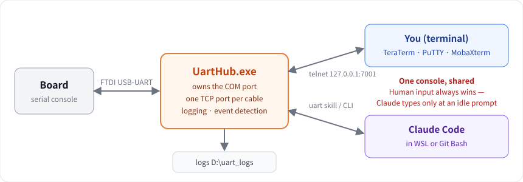
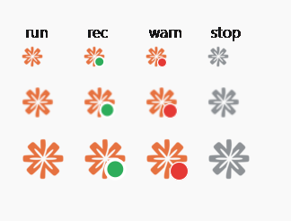
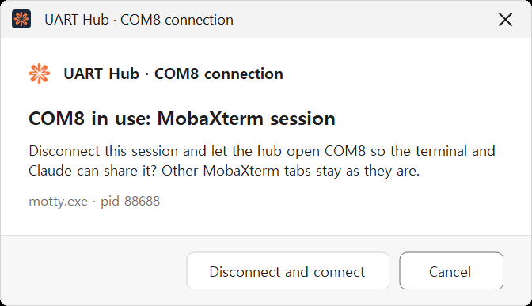
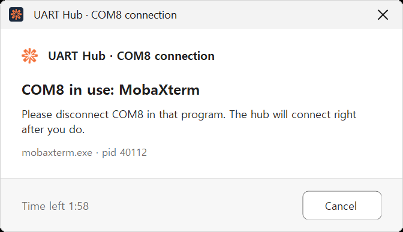
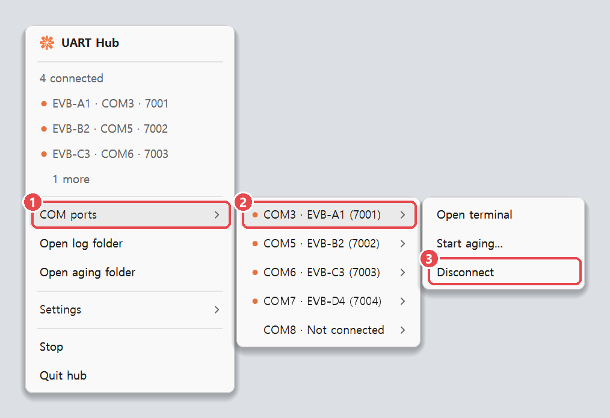
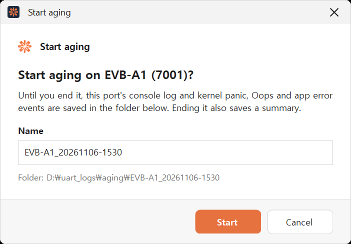
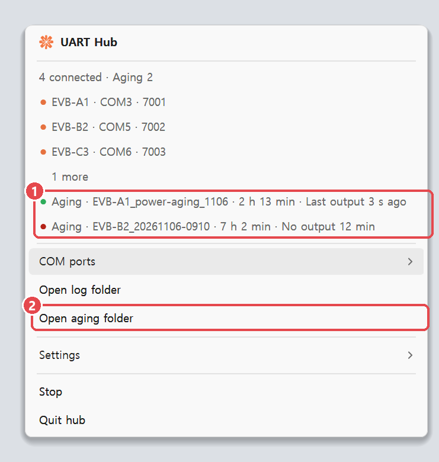
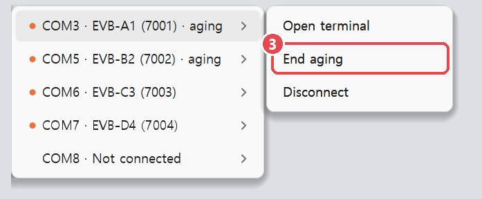

**English** | [한국어](GUIDE.ko.md)

# UART Hub user guide

UART Hub is a small Windows tray app that lets you and Claude Code share one board's serial console.
Keep your terminal open on the board, and ask Claude things like "run `uname` on this board" or "reboot it and tell me when it's back".
While a board is connected the hub keeps a log, and during an aging run it catches kernel panics, Oopses and app errors for you.



Your typing always comes first: while you are typing in the terminal, Claude sends nothing and waits.

> The app follows the Windows display language: Korean if Windows is set to Korean, otherwise English. To change it, use tray → **Settings ▸ Language** ([FAQ](#9-faq)).

## Contents

1. [What you need](#1-what-you-need)
2. [Install (once)](#2-install-once)
3. [Connect a board](#3-connect-a-board)
4. [Let Claude do the work](#4-let-claude-do-the-work)
5. [Programs that must open the COM port themselves (disconnect)](#5-programs-that-must-open-the-com-port-themselves-disconnect)
6. [Aging runs](#6-aging-runs)
7. [Where the logs are](#7-where-the-logs-are)
8. [Update, stop or remove](#8-update-stop-or-remove)
9. [FAQ](#9-faq)

---

## 1. What you need

| Item | Details |
|---|---|
| PC | Windows 10 / 11 (64-bit). No administrator rights needed |
| Cable | USB-UART cable with an **FTDI chip (VID_0403)**. To check: Device Manager → Ports (COM & LPT) → the cable → Properties → Details → Hardware Ids should contain `VID_0403`. Cables with other chips (CP210x, CH340, …) don't show up in `/connect-uart` |
| Claude Code | Running in WSL or on Windows (Git Bash) |
| Terminal (optional) | TeraTerm, PuTTY or MobaXterm. If you have none, get portable PuTTY and pick it via tray → Settings ▸ Terminal program ▸ Browse…. (The Windows telnet client is off by default and needs administrator rights to turn on.) |

## 2. Install (once)

The hub is **not installed**: it runs from the folder you unzip it to. It does not touch Startup or the registry.

1. Download `UartHub_<version>.zip` from [Releases](https://github.com/dltjrgud815/claude-uart-hub/releases) and unzip it.
2. Put the folder **where it will stay**, e.g. `C:\Tools\UartHub_<version>\`.
   - Not on a network share, a USB stick, or inside WSL.
   - After registering, don't move or delete the folder. The hub runs from there.
3. Ask Claude Code:
   ```
   Register the UART hub by following C:\Tools\UartHub_<version>\INSTALL_UART_HUB.en.md
   ```
   Claude shows what it will do, then registers the hub. No Windows dialog appears (Claude Code may ask you to allow the commands it runs).
4. You're done when an orange star icon appears at the right end of the taskbar. If you don't see it, look inside `^` (Show hidden icons).

   

   | Icon | Meaning |
   |---|---|
   | Orange star (run) | Hub is running |
   | Orange star + green dot (rec) | An aging run is recording |
   | Orange star + red dot (warn) | Needs attention: the hub keeps stopping, or the config file has an error |
   | Grey star (stop) | Stopped (tray → **Start** to resume) |

5. Type **`/connect-uart`** in Claude Code. If it isn't in the slash-command list, start a new Claude Code session.

> **Start automatically at logon** (do this yourself once): Win+R → `shell:startup` → in the folder that opens, **right-drag** `UartHub.exe` in and choose **"Create shortcuts here"**.
>
> **"The publisher could not be verified" warning when you open the desktop icon**: right-click `UartHub.exe` → Properties → tick **"Unblock"** at the bottom → OK. The exe is not code-signed, which is why Windows warns.

## 3. Connect a board

The hub only opens **the COM ports you tell it to**. Plugging in a cable is not enough.

| To do this | Type in Claude Code |
|---|---|
| List the plugged-in COM ports | `/connect-uart` |
| Connect COM3 | `/connect-uart COM3` |
| A board at another speed (e.g. 9600) | `/connect-uart COM3 9600` |
| Disconnect | `/disconnect-uart COM3` |

Once connected:

- A terminal opens right away: TeraTerm if it is installed, otherwise PuTTY, otherwise MobaXterm.
- A desktop icon such as **`EVB-A1 (7001)`** appears. After closing the terminal, double-click it to reopen.
- The port number (7001, 7002, …) is assigned on first connect and stays with that cable, so it helps to label your cables.
- The speed (115200 by default) is also remembered for that cable: later, `/connect-uart COM3` alone uses it. If the cable goes to a board at a different speed, the terminal shows garbage until you reconnect with the right speed.
- **Closing the terminal does not disconnect.** The hub keeps the COM port and keeps logging.

### Keep using MobaXterm

You can watch the same console in MobaXterm without disconnecting anything. In MobaXterm, create a new **Telnet** session to host `127.0.0.1`, port `7001` (that board's port number). It shares the console with the hub and Claude.

The terminal the desktop icon opens is set in tray → **Settings ▸ Terminal program**. Only programs that **must open the COM port themselves**, such as firmware download tools, need the disconnect in [section 5](#5-programs-that-must-open-the-com-port-themselves-disconnect).

### If another program is using that COM port

A dialog appears. What it offers depends on whether the hub recognizes the program.

**A MobaXterm session, TeraTerm, PuTTY or KiTTY:** click **Disconnect and connect**. The hub closes only that one session, then connects. Other MobaXterm tabs stay open.



**Any other program** (MobaXterm's main program holding the COM port itself, another serial program, …): the hub won't close it. Disconnect in that program and the hub connects right after. The dialog shows the time left; it waits up to 2 minutes. If you didn't make it in time, disconnect there and type `/connect-uart COM8` again.



## 4. Let Claude do the work

Refer to a connected board by its port number; that is the most precise way to name it.

| Say | What Claude does |
|---|---|
| "Run uname on board 7001" | Runs the command and returns the output and exit code |
| "Reboot board 7001 and tell me when it's back" | Reboots, then waits until the shell prompt returns |
| "Show me the last 50 lines of the 7001 console log" | Reads the saved log (sends nothing to the board) |
| "Start aging on 7001, call it nightly" | Starts an aging recording ([section 6](#6-aging-runs)) |
| "Summarize last night's aging on 7001" | Tabulates panics and reboots |

Good to know:

- If you are typing in the terminal, Claude does not send anything. It tells you that someone is typing and waits.
- Claude never connects or disconnects by itself. For a board that isn't connected it asks you to type `/connect-uart COMx`, because connecting can close another program's session and only a person should decide that.
- Claude Code asks for permission to run the hub command (once per project folder). Pick the option that stops it asking again.
- If Claude says the board has produced no output yet, check the board's power and wiring and press Enter in the terminal.

## 5. Programs that must open the COM port themselves (disconnect)

To just watch the console you don't need to disconnect ([Keep using MobaXterm](#keep-using-mobaxterm)). Disconnect only for programs that must open the COM port themselves, such as firmware download tools.
While the hub holds a COM port, no other program can open it, even after you close the Claude session or replug the cable.

**Right-click** the orange star in the tray → **① COM ports** → **② that COM port** → **③ Disconnect**



Typing `/disconnect-uart COM3` in Claude Code does the same. After that the hub leaves the port alone until you `/connect-uart` again.

> To pause the whole hub for a while, use **Stop** in the tray menu, and **Start** to resume.

## 6. Aging runs

You name an aging run when you start it and use the same name to end it. Its console log and events go into one folder named after the run.

> **Before an overnight run**
> - Turn off PC sleep.
> - Create the logon shortcut from [section 2](#2-install-once). Without it, the hub does not start by itself when you log on again.
> - Aging starts only on a connected COM port, so `/connect-uart COMx` first.

**To catch app errors too**, get your team's product profile `UartHub.profile.json` from whoever looks after the hub (or the board's firmware owner) and put it next to the exe. Without it the hub catches only kernel errors such as panics and Oopses, plus reboots. The format is in [Product profile in the README](../README.md#product-profile-uarthubprofilejson).

### Start

Tray → COM ports → that COM port → **Start aging…** → pick a name → **Start**. The default name is `<board>_<date-time>`.



Or tell Claude: "Start aging on 7001, call it nightly".

### Check that it is recording



- **① Status lines**: one per aging run, showing **run name · elapsed time · last output**. A green dot means output is coming in; a **red dot (No output N min)** means nothing has arrived for over 10 minutes: check the board and cable. This shows only in the tray menu.
- **② Open aging folder** opens `D:\uart_logs\aging`, where all aging run folders are.
- The tray icon gets a **green dot**, and the terminal's window title ends with " · aging".



- **③ End aging**: tray → COM ports → that COM port (**· aging**) → **End aging**. It stops recording and writes the summary. Or tell Claude: "End aging on 7001 and summarize".

### What gets saved

Inside `D:\uart_logs\aging\nightly_20261106-2130\`:

| File | Contents |
|---|---|
| `console.log` | Every console line from that port |
| `events\` | One txt per notified event, e.g. `031207_kernel-panic.txt`, `180212_app-error_APPFAULT(ED).txt` |
| `summary.txt` | Written when you end the run: duration · boot count · events · gaps in recording |

- **Balloon notifications appear only for kernel panic, Oops and app errors** (including "rebooted after a panic" and "no response after a panic"). Click the balloon to open that txt in Notepad.
- Other reboots, BUGs and OOMs **don't get a txt**. They appear only in `summary.txt` (boot count, event list) and in Claude's summary. A power on/off aging run resets the board every cycle, so notifying every reboot would be noise.

An event txt starts with a header like this, then the 200 lines before and the lines after, and ends with a **`Result:`** line. Values are examples.

```
Event: Kernel panic
Board: EVB-A1 (port 7001 · COM3)
Time: 2026-11-07 03:12:07.412 (1843.2 s after boot)
Cause line: [ 1843.207114] Kernel panic - not syncing: Fatal exception
Console log file: D:\uart_logs\aging\nightly_20261106-2130\console.log
----- 200 lines before -----
…
Result: rebooted at 03:12:09 (hard reset).
```

The other results are "no response" and "kept running". `summary.txt` looks like this (shortened):

```
Aging summary
Name: nightly
Board: EVB-A1 (port 7001 · COM3)
Period: 2026-11-06 21:30:00 ~ 2026-11-07 08:42:10 (11 h 12 min)
Boots: 2 total · command (cmd) 1 · soft 0 · hard 1 (unexpected reboots: 1)
Events: 1
  03:12:07  kernel panic  [ 1843.207114] Kernel panic - not syncing: Fatal exception  → events\031207_kernel-panic.txt
Recording gaps: none
```

In the morning, ask Claude **"Summarize last night's aging on 7001"** for a table of events. It only reads files; nothing is sent to the board.

#### More to know

- **Errors seen inside a command's output** (`dmesg`, `cat` of a log file, …) may be old logs, so their txt name ends in `_suspect` and no balloon is shown. If the board then resets or stops responding, you are notified at that point.
- When output has been quiet for 10 seconds, that command's output is treated as finished. If you leave `tail -f` or an aging script running and walk away, errors after that are notified normally.
- **If a board that does reboot shows 0 reboots in the summary**, the hub doesn't recognize that board's boot lines. Claude counts them from the console log and tells you; once the product profile defines that board's boot lines, the hub counts them from then on.
- If the hub is restarted, recording continues into the same aging run.

## 7. Where the logs are

- The default is `D:\uart_logs` (or `%USERPROFILE%\uart_logs` if there is no D: drive). Tray → **Open log folder** opens it.
- Each aging run gets a folder under `aging\`. Hub settings and `hub.log` are in `hub\`.
- A run started while the app was in Korean is under `에이징\` and keeps its Korean file names (`콘솔.log`, `이벤트\`, `요약.txt`).
- Console lines outside an aging run are kept in a hidden temporary area for **24 hours only** (2 GB max in total). Outside an aging run there is also no event detection and no balloon. Use an aging run for anything you need to keep or watch.
- Don't delete `hub\config.json`.

## 8. Update, stop or remove

| To do this | How |
|---|---|
| Update | Get the new `UartHub_<new version>` folder and ask the same thing: "Register the UART hub by following `<new folder>\INSTALL_UART_HUB.en.md`". Ports, connections and logs carry over. Copy `UartHub.profile.json` into the new folder if you have one, and recreate the logon shortcut for the new exe. Delete the old folder yourself once you're happy |
| Stop | Tray → **Quit hub**. It starts again when Claude calls the hub or you click a desktop board icon |
| Remove | Ask Claude: "Remove the UART hub as described in INSTALL_UART_HUB.en.md". It removes the desktop icons, the Claude skills and the settings file; **the exe and the logs stay**. Delete the logon shortcut yourself |

## 9. FAQ

**I can't see the tray icon.**
It is inside `^` (Show hidden icons) at the right end of the taskbar. Drag it out to keep it visible.

**`/connect-uart` is not in the command list.**
Start a new Claude Code session. If you installed Claude Code after the hub, ask Claude to register the hub again (section 2).

**The app shows Korean. How do I switch?**
Tray → **Settings ▸ Language ▸ English**. **Auto** (the default) follows the Windows display language: Korean if Windows is set to Korean, otherwise English. The hub asks before switching because it restarts: open terminals lose their connection (reopen them from the desktop board icons), and aging runs keep recording. Each aging run keeps the language it started in, so a run started in Korean keeps its Korean folder and file names.

**The COM numbers of my 4-channel adapter changed.**
Windows assigns new numbers when the adapter goes into a different USB port. Always use the same USB port. Old entries can be removed from tray → Settings → **Clean up disconnected UARTs…**.

**Something is acting strange.**
Tray → **Quit hub** → double-click `UartHub.exe` in its folder. If it persists, attach tray → **Open log folder** → `hub\hub.log` and report it: to the person you got the hub from if it came from your team, otherwise as a [GitHub issue](https://github.com/dltjrgud815/claude-uart-hub/issues).

**What about CH340 or CP210x cables?**
Only FTDI (VID_0403) is recognized for now.

**Can Claude interrupt what I'm typing?**
No. Claude types only when the board is waiting at its shell prompt (`#` or similar) and nobody is typing. If `tail -f` or an app is running in the foreground, it doesn't send; it waits and tells you so.

---

Every command, exit code and config key, plus building and testing, is in the [Technical reference](REFERENCE.md). [USAGE_ONE_PAGE.en.md](../USAGE_ONE_PAGE.en.md) is a one-page summary.
