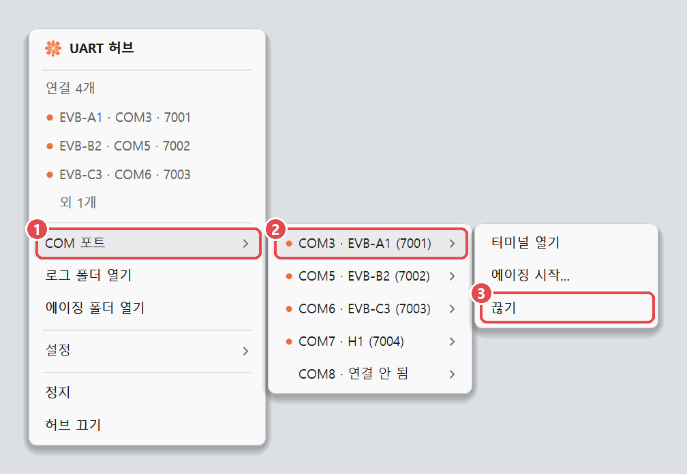

**English** | [한국어](GUIDE.ko.md)

# UART Hub — User Guide

UART Hub is a small Windows tray app that lets **you and Claude Code share one board's serial console**.
Keep your terminal open on the board, and ask Claude things like "run `uname` on this board" or "reboot it and tell me when it's back".
While a board is connected the hub keeps a log, and during an aging run it catches kernel panics, Oopses and app errors for you.


**Your input always wins.** If you are typing in the terminal, Claude does not send anything; it waits.

> The app's menus, dialogs and messages are in Korean. This guide quotes each Korean label as it appears on screen, followed by its meaning, e.g. "끊기" (Disconnect).

## Contents

1. [What you need](#1-what-you-need)
2. [Install — once](#2-install--once)
3. [Connect a board](#3-connect-a-board)
4. [Let Claude do the work](#4-let-claude-do-the-work)
5. [Use the port from your own serial program (disconnect)](#5-use-the-port-from-your-own-serial-program-disconnect)
6. [Aging runs](#6-aging-runs)
7. [Where the logs are](#7-where-the-logs-are)
8. [Update · stop · remove](#8-update--stop--remove)
9. [FAQ](#9-faq)

---

## 1. What you need

| Item | Details |
|---|---|
| PC | Windows 10 / 11 (64-bit). No administrator rights needed |
| Cable | USB-UART cable with an **FTDI chip (VID_0403)**. CP210x and CH340 cables are not recognized yet |
| Claude Code | Running in WSL or on Windows (Git Bash) |
| Terminal (optional) | TeraTerm, PuTTY or MobaXterm. Without one, telnet to `127.0.0.1:<port>` |

## 2. Install — once

The hub is **not installed**: it runs from the folder you unzip it to. It does not touch Startup or the registry.

1. Download `UartHub_<version>.zip` from [Releases](https://github.com/dltjrgud815/claude-uart-hub/releases) and unzip it.
2. Put the folder **where it will stay**, e.g. `C:\Tools\UartHub_<version>\`.
   - Not on a network share, a USB stick, or inside WSL.
   - After registering, don't move or delete the folder — the hub runs from there.
3. Ask Claude Code:
   ```
   Register the UART hub by following C:\Tools\UartHub_<version>\INSTALL_UART_HUB.md
   ```
   Claude shows what it will do, then registers the hub. No double-click and no dialogs. (The install instructions are written in Korean for Claude; asking in English is fine.)
4. Done when an **orange star icon** appears at the right end of the taskbar. If you don't see it, look inside `^` (Show hidden icons).

   

   | Icon | Meaning |
   |---|---|
   | Orange star (run) | Hub is running |
   | Orange star + green dot (rec) | An aging run is recording |
   | Orange star + red dot (warn) | Needs attention — the hub keeps stopping, or the config file has an error |
   | Grey star (stop) | Stopped (tray → "시작" (Start) to resume) |

5. Type **`/connect-uart`** in Claude Code. If it isn't in the slash-command list, start a new Claude Code session.

> **Start automatically at logon** (do this yourself once): Win+R → `shell:startup` → in the folder that opens, **right-drag** `UartHub.exe` in and choose **"Create shortcuts here"**.
>
> **"The publisher could not be verified" warning**: right-click `UartHub.exe` → Properties → tick **"Unblock"** at the bottom → OK. The exe is not code-signed, which is why Windows warns.

## 3. Connect a board

The hub only opens **the COM ports you tell it to**. Plugging in a cable is not enough.

| To do this | Type in Claude Code |
|---|---|
| List the plugged-in COM ports | `/connect-uart` |
| Connect COM3 | `/connect-uart COM3` |
| A board at another speed (e.g. 9600) | `/connect-uart COM3 9600` |
| Disconnect | `/disconnect-uart COM3` |

Once connected:

- **A terminal opens right away** — the first one found of TeraTerm → PuTTY → MobaXterm.
- A desktop icon such as **`EVB-A1 (7001)`** appears. After closing the terminal, double-click it to reopen.
- The port number (7001, 7002, …) is assigned on first connect and **stays with that cable**. Labelling your cables helps.
- **Closing the terminal does not disconnect.** The hub keeps the COM port and keeps logging. To release it, see [section 5](#5-use-the-port-from-your-own-serial-program-disconnect).

### If another program is using that COM port

A dialog appears. What it offers depends on whether the hub recognizes the program.

**A MobaXterm session, TeraTerm, PuTTY or KiTTY** — click **"끊고 연결"** (Disconnect and connect) to close **only that one session**, then connect. Other MobaXterm tabs stay open.


**Any other program** — the hub won't close it. Disconnect in that program and the hub **connects right after** (it waits up to 2 minutes).


## 4. Let Claude do the work

Refer to a connected board by its **port number** — that is the most precise.

| Say | What Claude does |
|---|---|
| "Run uname on board 7001" | Runs the command and returns the output and exit code |
| "Reboot board 7001 and tell me when it's back" | Reboots, then waits until the shell prompt returns |
| "Show me the last 50 lines of the 7001 console log" | Reads the saved log (sends nothing to the board) |
| "Start aging on 7001, call it nightly" | Starts an aging recording ([section 6](#6-aging-runs)) |
| "Summarize last night's aging on 7001" | Tabulates panics and reboots |

Good to know:

- **If you are typing in the terminal, Claude does not send.** It tells you a human is typing and waits.
- Claude **never connects or disconnects by itself**. For a board that isn't connected it asks you to type `/connect-uart COMx` — connecting can close another program's session, so only a person does it.
- The first time, Claude Code asks for **permission to run** the hub command once. Pick the option that stops it asking again.
- If Claude says the board has produced no output yet, check the board's power and wiring and press Enter in the terminal.

## 5. Use the port from your own serial program (disconnect)

While the hub holds a COM port, no other program can open it — even after you close the Claude session or replug the cable. **Disconnect it first.**

**Right-click** the orange star in the tray → **① "COM 포트"** (COM ports) → **② that COM port** → **③ "끊기"** (Disconnect)



Typing `/disconnect-uart COM3` in Claude Code does the same. After that the hub leaves the port alone until you `/connect-uart` again.

> To pause the whole hub for a while, use **"정지"** (Stop) in the tray menu, and **"시작"** (Start) to resume.

## 6. Aging runs

An aging run is **started and ended by name**. Everything in between — console log and events — goes into one folder.

### Start

Tray → "COM 포트" (COM ports) → that COM port → **"에이징 시작…"** (Start aging…) → pick a name → **"시작"** (Start). The default name is `<board>_<date-time>`.


Or tell Claude: "Start aging on 7001, call it nightly".

### Check that it is recording


- **① Status lines** show each board being aged and for how long. A green dot means output is coming in; a **red dot ("출력 없음 N분", no output for N min)** means nothing for over 10 minutes — check the board and cable.
- **② "에이징 폴더 열기"** (Open aging folder) opens the recording folder.
- **③ "에이징 끝내기"** (End aging) stops recording and writes the summary. Or tell Claude: "End aging on 7001 and summarize".
- The tray icon gets a **green dot**, and the terminal's window title ends with " · 에이징 중" (aging).

### What gets saved

```
D:\uart_logs\에이징\nightly_20261106-1530\      (에이징 = aging)
├─ 콘솔.log        (console log) every console line from that port
├─ 이벤트\          (events) one txt per notable event
│   ├─ 173851_커널패닉.txt                  (kernel panic)
│   └─ 180212_앱오류_APPFAULT(ED).txt        (app error)
└─ 요약.txt        (summary) written when you end the run: duration · boot count · events · gaps
```

- **Balloon notifications appear only for kernel panic, Oops and app errors** (including "rebooted after a panic" and "no response after a panic"). Click the balloon to open that txt in Notepad.
- Other reboots, BUGs and OOMs are **recorded only**. A power on/off aging run resets the board every cycle, so notifying every reboot would be noise.
- Each event txt starts with the kind, board, time and the line that triggered it, then the 200 lines before and the lines after, and ends with **`결과:`** (outcome: rebooted / no response / kept running).
- **Errors seen inside a command's output** (`dmesg`, `cat` of a log file, …) may be old logs, so they are recorded with a `_의심` (suspect) suffix only. If the board then resets or stops responding, you are notified at that point.
- Catching **app errors** needs a **product profile** (`UartHub.profile.json`) for your firmware, placed next to the exe — see [Product profile in the README](../README.md). Kernel panics, Oopses and reboots are caught without one.
- **If a board that does reboot shows 0 reboots in the summary**, the hub doesn't recognize that board's boot lines (a different loader banner, or a quiet kernel). Claude counts them from the console log and tells you; set `loader_marker_re` / `boot_re` in the product profile for that board and the hub will count them from then on.
- If the hub is restarted, recording continues into the same aging run.

In the morning, ask Claude **"Summarize last night's aging on 7001"** for a table of events. It only reads files; nothing is sent to the board.

## 7. Where the logs are

- The default is `D:\uart_logs` (or `%USERPROFILE%\uart_logs` if there is no D: drive). Tray → **"로그 폴더 열기"** (Open log folder) opens it.
- Each aging run gets a folder under `에이징\` (aging). Hub settings and `hub.log` are in `hub\`.
- Console lines outside an aging run are kept in a hidden temporary area for **24 hours only** (2 GB max in total). Use an aging run for anything you need to keep.
- Don't delete `hub\config.json`.

## 8. Update · stop · remove

| To do this | How |
|---|---|
| Update | Get the new `UartHub_<new version>` folder and ask the same thing: "Register the UART hub by following `<new folder>\INSTALL_UART_HUB.md`". Ports, connections and logs carry over. Delete the old folder yourself once you're happy |
| Stop | Tray → **"허브 끄기"** (Quit hub). It starts again when Claude calls the hub or you click a desktop board icon |
| Remove | Ask Claude: "Remove the UART hub as described in INSTALL_UART_HUB.md". It removes the desktop icons, the Claude skills and the registration; **the exe and the logs stay** |

## 9. FAQ

**I can't see the tray icon.**
It is inside `^` (Show hidden icons) at the right end of the taskbar. Drag it out to keep it visible.

**`/connect-uart` is not in the command list.**
Start a new Claude Code session. If you installed Claude Code after the hub, ask Claude to register the hub again (section 2).

**The COM numbers of my 4-channel adapter changed.**
Windows assigns new numbers when the adapter goes into a different USB port. Always use the same USB port. Old entries can be removed from tray → "설정" (Settings) → **"미연결 UART 정리"** (Clean up disconnected UARTs).

**Something is acting strange.**
Tray → **"허브 끄기"** (Quit hub) → double-click `UartHub.exe` in its folder. If it persists, open an [issue](https://github.com/dltjrgud815/claude-uart-hub/issues) and attach `D:\uart_logs\hub\hub.log`.

**What about CH340 or CP210x cables?**
Only FTDI (VID_0403) is recognized for now.

**Can Claude interrupt what I'm typing?**
No. The hub tracks the shell prompt and sends Claude's input only when the shell is idle at a prompt and nobody is typing. Otherwise it sends nothing and tells Claude to wait (exit code 101).

---

For the full details — every command, exit codes, config keys, building and testing — see the [README](../README.md) and [USAGE_ONE_PAGE.md](../USAGE_ONE_PAGE.md) (Korean).
